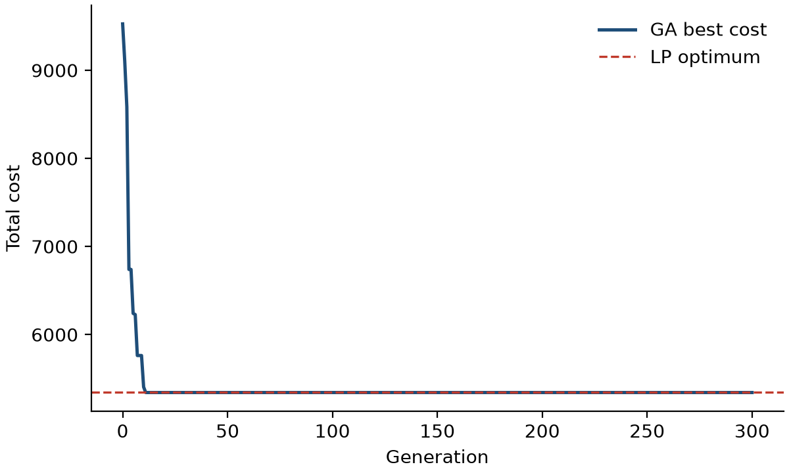
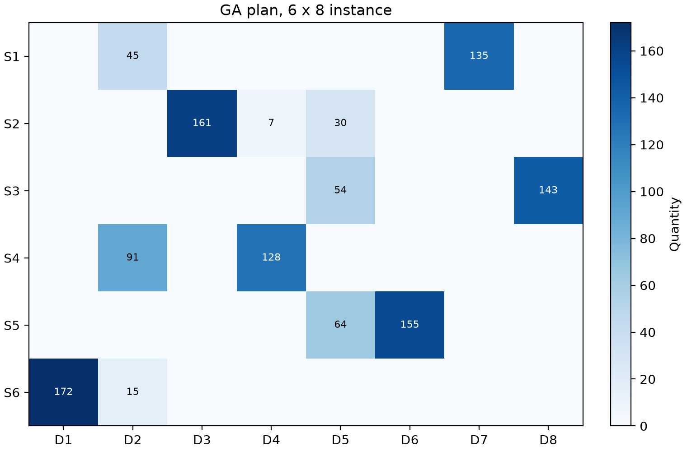

# tp-ga — modelling and optimisation of the transportation problem with genetic algorithms

[](https://github.com/Almasmm/tp-ga/actions/workflows/ci.yml)
[](https://github.com/Almasmm/tp-ga/actions/workflows/release.yml)
[](LICENSE)


The code base of the master's research project *Modelling and optimisation of the transportation problem using
genetic algorithms* (Astana IT University). It contains the `tpga` Python library and, as it grows, the web
platform built on it. The library solves the classical transportation
problem with a **permutation-encoded genetic algorithm** whose individuals are turned into shipment plans by a
**greedy decoder**, and reports every GA result against the **exact linear-programming optimum**.

## Problem

Minimise $Z = \sum_i \sum_j c_{ij} x_{ij}$ subject to $\sum_j x_{ij} = a_i$, $\sum_i x_{ij} = b_j$, $x_{ij} \ge 0$.

A chromosome is a permutation of the $m \cdot n$ arcs. The decoder visits the arcs in that order and assigns
$x_{ij} = \min(a_i^{(r)}, b_j^{(r)})$, the smaller of the remaining supply and demand. For a balanced problem
with a complete arc set every chromosome therefore decodes to a feasible plan, and no penalty or repair is needed.
The guarantee does **not** extend to arc capacities, fixed charges or time windows, and says nothing about optimality.
Because exact methods solve the classical model directly, `tpga` always computes the LP optimum as a reference.

## Installation

```bash
git clone https://github.com/Almasmm/tp-ga.git
cd tp-ga
pip install -e .            # library and CLI
pip install -e .[dev]       # plus pytest, ruff, mypy, build
```

## Usage

Command line:

```bash
tpga generate instance.json -m 6 -n 8 --seed 42
tpga solve examples/small_3x3.json --seed 0
tpga solve examples/random_6x8.json --method both --seed 0 --plot conv.png --plan-plot plan.png --json
```

```text
instance: 3 sources x 3 destinations, balanced=True
LP optimum: 225.0000
GA best:    225.0000  (gap 0.00%, 12060 evaluations, 0.41s)
```

Python API:

```python
from tpga import TransportProblem, GAConfig, run_ga, solve_lp

p = TransportProblem(supply=[20, 30, 20], demand=[25, 25, 20], cost=[[8, 6, 3], [5, 4, 9], [2, 7, 6]])
x_lp, z_lp = solve_lp(p)  # exact optimum: 225
r = run_ga(p, GAConfig(population=60, generations=200, seed=0))
print(r.cost, r.evaluations, p.is_feasible(r.x))
```

Unbalanced instances are balanced automatically with a zero-cost dummy source or destination.

| Convergence on `examples/random_6x8.json` | Best plan |
|---|---|
|  |  |

One run with seed 0 (population 80, 300 generations): GA cost 5342, LP optimum 5342.
This illustrates the tool; it is not a benchmark, and a single run says nothing about average behaviour.

## Computational experiment

The experiment of the paper *Genetic algorithm with permutation encoding and greedy decoding for the
balanced transportation problem: a computational comparison with exact and classical methods* is defined
in [`experiments/paper.yaml`](experiments/paper.yaml) and runs with one command; every table and figure is
then regenerated from the raw results with a second one:

```bash
pip install -e .[dev]
python -m tpga.experiments.run --config experiments/paper.yaml       # resumable; --pilot estimates the duration
python -m tpga.experiments.report --config experiments/paper.yaml
```

The results, instances, figures (English and Russian), tables, `METHODS.md`, `LIMITATIONS.md` and
`NUMBERS.md` (every number with its source) are in [`paper_artifacts/`](paper_artifacts/README.md).

### Quick run of the v0.4 experiment

A short version of the experiment of v0.4 (work in progress, branch `work/v0.4`) is defined in
[`experiments/paper-v2-quick.yaml`](experiments/paper-v2-quick.yaml): uniform instances 5x5 to 50x50 and
structured 20x20, 10 instances per size, 10 seeds, budget of 200 m n decoder calls, the methods LP, NWC, LCM,
VAM, RS and the tuned GA and SA (random and cost-aware start), the phases `reference`, `representation` and
`main`. One command runs it (4 500 runs, about 8 minutes on 24 logical processors) and writes the tables and
figures:

```bash
pip install -e ".[runner]"
python scripts/run_main.py --config experiments/paper-v2-quick.yaml --priority normal --phase reference --phase representation --phase main
```

The results of the run of 2026-11-18 are in [`paper_artifacts_quick/`](paper_artifacts_quick/): `tables/`,
`figures/`, `raw/` (every run record), `run_manifest.json` and `PROGRESS.md`. This run is **not** part of the
pre-registered plan of v0.4 (`docs/v0.4/PREREGISTRATION.md`) and does not replace it; it uses the first
instances and seeds of that plan and the frozen parameters `experiments/tuned-v2.yaml`. Run times in it were
measured with 24 runs at once and are not a timing result.

### Additional experiment v3: cycle mutation and the fixed-charge problem

Branch `work/v0.4` also holds an experiment that was planned in amendment 8 of
[`docs/v0.4/PREREGISTRATION.md`](docs/v0.4/PREREGISTRATION.md) before its code was written: a mutation that
makes random simplex pivots on the decoded plan (`tpga.cycle`), one protocol for the linear problem up to
100x100, and the fixed-charge transportation problem (`tpga.fctp`) with a MIP reference and three MIPLIB
instances. Amendment 9 extends it after its results were seen: the 100x100 set with all 10 instances, a grid
on FCTP training instances, the MIP solver with the run time of the GA as its limit, and FCTP sizes 50x50 and
70x70. Commands, tables and limits are in [`paper_artifacts_v3/README.md`](paper_artifacts_v3/README.md);
the experiment of amendment 8 takes about an hour on 24 logical processors and the extension another hour:

```bash
pip install -e ".[runner]"
python -m tpga.experiments.v3 kselect --config experiments/paper-v3-cycle.yaml      # then pilot, run, extend, report
python -m tpga.experiments.v3 run     --config experiments/paper-v3-fctp.yaml       # then benchmark, report
python -m tpga.experiments.v3 tune    --config experiments/paper-v3-fctp-ext.yaml   # then run, report
python -m tpga.experiments.v3 pilot   --config experiments/paper-v3-review.yaml     # amendment 10, see below
```

Amendment 10 answers a review and is exploratory as well (`experiments/paper-v3-review.yaml`, results in
`paper_artifacts_v3/review/`): a tabu search and an iterated local search over basis pivots
(`tpga.localsearch`) as rivals on the fixed-charge problem, the MIP solver with all threads and 300 s, new
instance classes and ten public instances, times with one run at a time, the share of pivots with theta > 0,
a second rule for the entering arc of the cycle mutation (`GAXConfig(entering="nondegenerate")`), effect
sizes with intervals and three figures. With the same budget of evaluations both local searches are better
than the GA on the fixed-charge problem. Its commands are `pilot`, `tune`, `rivals`, `generator`,
`degenerate`, `public`, `timing`, `mipdefault` and `report`, in this order; together they took 84 minutes.

## Project structure

```text
src/tpga/              model, decoder, ga (+ compiled _kernels), exact, classical, basis, verify, ga_trace, cli, plot
src/tpga/experiments/  configuration, instance sets, runner, reachability check, report
experiments/           paper.yaml
paper_artifacts/       instances, raw results, tables, figures and documents of the paper
platform/              FastAPI backend (app/, migrations/, tests/), Next.js interface (web/), Dockerfile, docker-compose
datasets/              kazakh-wheat (with rail-pilot), astana-potato
scripts/               dev.ps1 (local platform), benchmark.py, rail tools
tests/                 unit, property (hypothesis), kernel, experiment and CLI tests (pytest)
.github/               CI and release workflows, Dependabot, issue and PR templates
```

## Web platform

The [web application](platform/README.md) plans shipments for the Kazakhstan wheat case and the full Astana benchmark. It compares random and cost-aware GA starts with the LP optimum. The platform includes a Next.js interface and a FastAPI backend.

## Technology choices

| Need | Choice | Why |
|---|---|---|
| Language | **Python 3.10+** | Standard in scientific computing; the numerical stack below is mature; readable for reviewers of the research. |
| Arrays | **NumPy** | Vectorised plan and cost arithmetic; reproducible random streams via `numpy.random.Generator`. |
| Inner loops | **numba** | Decoder and GA operators compiled to machine code; the same functions run as plain Python in the tests. |
| Exact baseline | **SciPy `linprog` (HiGHS)** | Open-source, state-of-the-art LP solver shipped with SciPy, so no extra dependency or licence. |
| Plots | **matplotlib** | De-facto standard for publication figures; works headless in CI (`Agg` backend). |
| Tests | **pytest** (+ pytest-cov) | Concise fixtures and parametrisation; coverage gate of 90 % in CI. |
| Style / lint | **ruff** | One fast tool for linting, import sorting and formatting. |
| Types | **mypy** | Catches interface errors in numerical code before runtime. |
| Web API | **FastAPI** | Typed request/response models (pydantic), automatic OpenAPI docs, built-in test client. |
| Packaging | **pyproject.toml + setuptools** | PEP 621 standard metadata; `pip install -e .` and a `tpga` console script. |
| VCS / hosting | **Git + GitHub** | Issues, pull requests, branch protection and Actions in one place. |
| CI/CD | **GitHub Actions** | Native to GitHub; free for public repositories; matrix builds on Linux and Windows. |

## Quality checks and CI/CD

- [`ci.yml`](.github/workflows/ci.yml) — on every push and pull request: ruff lint and format check, mypy, then the
  test suite on **Ubuntu and Windows × Python 3.10–3.14** with a 90 % coverage gate, the platform API
  tests and the web job (ESLint, `next build`, Playwright), then a package build
  whose wheel is installed in a clean environment and smoke-tested with the CLI.
- [`release.yml`](.github/workflows/release.yml) — on a tag `vX.Y.Z`: runs the tests, checks that the tag equals the
  package version, builds the sdist and wheel and publishes them as a **GitHub Release** (continuous delivery).
- [`paper-release.yml`](.github/workflows/paper-release.yml) — on a tag `vX.Y.Z-paper` (code and data of the
  article): one archive of the tracked files of `paper_artifacts_v2/`, `paper_artifacts_quick/` and
  `paper_artifacts_v3/` with the preregistration and the configurations, attached to a **GitHub Release**.
- [`dependabot.yml`](.github/dependabot.yml) — monthly update pull requests for actions and Python dependencies.
- `main` is protected: changes arrive through pull requests that must pass CI.

Run the same checks locally:

```bash
ruff check . && ruff format --check . && mypy && pytest --cov=tpga
```

## Contributing, citation, licence

See [CONTRIBUTING.md](CONTRIBUTING.md) and [CHANGELOG.md](CHANGELOG.md). Citation metadata is in
[CITATION.cff](CITATION.cff). Released under the [MIT licence](LICENSE).

Author: Almas Murat, Astana IT University. ORCID [0009-0008-6202-088X](https://orcid.org/0009-0008-6202-088X).
